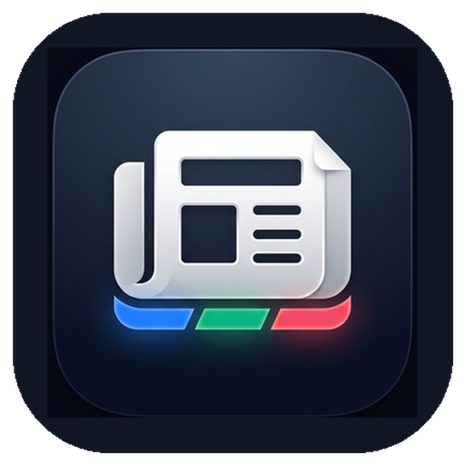
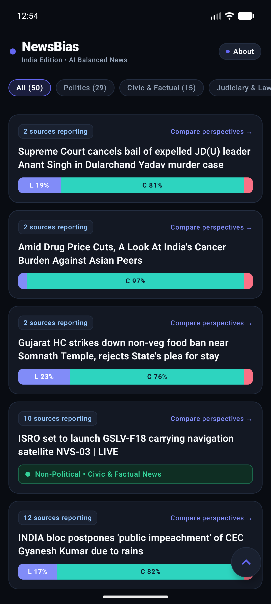
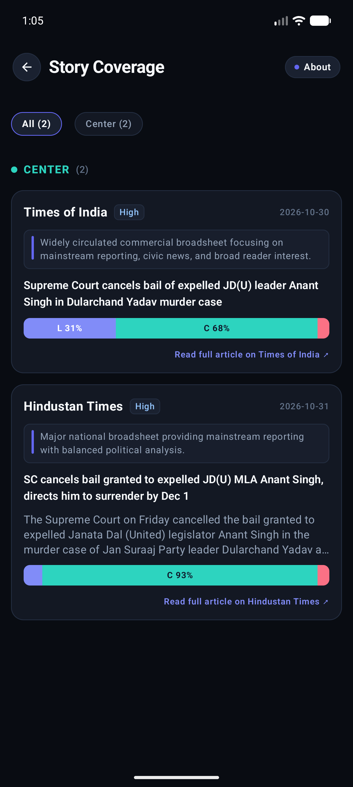
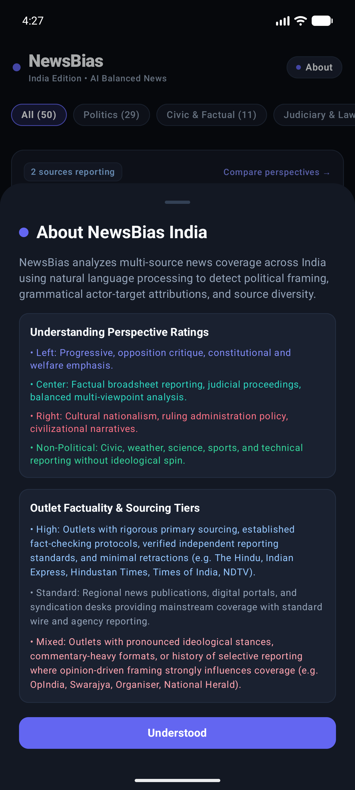
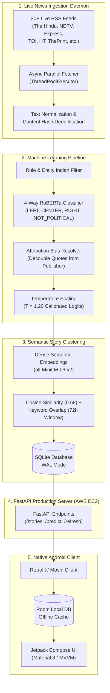

<div align="center">
  
  <h1>NewsBias</h1>
  <p><strong>AI-Powered Multi-Perspective News Analysis & Bias Detection for India 🇮🇳</strong></p>

  [](https://github.com/codingsoham/NewsBiasDetection/releases/download/v1.0.0/NewsBias-v1.0.0.apk)
  [](https://huggingface.co/codingsoham/newsbias-indic-roberta)
  [-FF9900?logo=amazon-aws&logoColor=white)](http://54.206.165.74:8000/health/model)
  [](LICENSE)
</div>

A full-stack, production-ready news bias transparency platform inspired by **Ground News**, built specifically for Indian socio-political journalism. 

NewsBias monitors live feeds from major Indian outlets, clusters them into multi-source stories using semantic sentence embeddings, decouples speaker quotation from publisher editorial bias via an attribution resolver, and renders balanced perspective distributions on a native Android mobile application.

---

## 📱 App Showcase

| 📰 Live Multi-Source Feed | 🔍 Deep Perspective Comparison | ℹ️ Sourcing Rigor & Methodology |
| :---: | :---: | :---: |
|  |  |  |
| *Real-time category filtering (`All`, `Politics`, `Civic & Factual`, `Judiciary & Law`), multi-source badges, and stacked bias breakdown bars.* | *Side-by-side outlet perspective comparison, editorial track records, and sourcing rigor tiers.* | *Interactive transparency sheet explaining calibration temperature ($T=1.20$), attribution decoupling, and sourcing rigor tiers.* |

---

## 🏛️ System Architecture



---

## 💡 The Core Problem & Key Innovations

Political journalism in India presents unique challenges that standard Western media bias models completely fail to address:

### 1. The "Attribution Bias" Dilemma
* **The Failure**: When a politician (e.g., from Congress or BJP) makes an aggressive partisan statement during an election rally, an objective newspaper like *The Hindu* or *Times of India* reports the speech verbatim inside quotation marks. Naïve sentiment and bias models flag the *newspaper* as partisan simply because the text contains political rhetoric.
* **Our Solution**: We engineered a custom **Attribution Bias Resolver** ([`backend/attribution_resolver.py`](backend/attribution_resolver.py)). It identifies quoted clauses, speaker attributions (e.g., *"Rahul Gandhi said..."*, *"PM Modi stated..."*, *"Supreme Court held..."*), and suppresses false positives, evaluating the publisher's journalistic frame rather than the speaker's rhetoric.

### 2. Dedicated Non-Political Gating
* Not all news is ideological. Scientific achievements (*ISRO satellite launches*), infrastructure (*highways, rail projects*), civic updates, and sports shouldn't be forced onto a Left-Right political spectrum.
* NewsBias incorporates an explicit **4th class (`NOT_POLITICAL`)** with strict gating ($F_1 = 0.860$), rendering clean green informational badges instead of artificial partisan bars.

### 3. Sourcing Rigor Tiering
We established transparent, published sourcing tiers to evaluate reporting reliability:
* **High Rigor**: Established national newsrooms with strict editorial oversight, field reporters, and named sourcing standards (e.g., *The Hindu*, *Indian Express*, *Hindustan Times*).
* **Standard Rigor**: Fast-paced digital-first outlets with mixed syndication wire services (e.g., *India Today*, *NDTV*, *Times of India*).
* **Mix / Opinion**: Digital platforms prioritizing partisan analysis, ideological commentary, or opinion-driven reporting.

---

## 🔬 How We Built It from Scratch: The 7-Step Journey

### Step 1: Real-Time Data Collection
* Engineered automated scrapers in [`ml/collect_indian.py`](ml/collect_indian.py) and [`backend/ingest.py`](backend/ingest.py) fetching from 20+ feeds.
* Features SHA256 content-hash deduplication, URL normalization (stripping tracking query params like `utm_*` and `fbclid`), and parallel multi-threaded HTTP extraction.

### Step 2: Corpus Annotation & Gold Benchmark
* Collected 3,000+ real-world articles.
* Run dual-pass LLM silver labeling with inter-annotator agreement verification (Cohen's $\kappa = 0.828$).
* Constructed a pristine 250-article human-curated **Gold Benchmark** with publisher-held-out testing (outlets in the test set were completely absent during training to verify true zero-shot generalization).

### Step 3: Indic-RoBERTa Model Fine-Tuning
* Fine-tuned a domain-adapted RoBERTa model (`roberta-base`) on the balanced corpus using class-weighted focal loss to counter political class imbalance.
* Achieved **67.2% Accuracy** and **0.609 Macro $F_1$** on the untouched gold test benchmark.

### Step 4: Probabilistic Temperature Calibration ($T=1.20$)
* Raw neural network logits frequently suffer from overconfidence.
* In [`ml/calibrate.py`](ml/calibrate.py), we computed post-hoc temperature scaling via validation Negative Log-Likelihood (NLL) optimization, locking in $T = 1.199995 \approx 1.20$.
* This guarantees that probabilities reflect true empirical frequencies.

### Step 5: Semantic Clustering Engine
* Uses `sentence-transformers/all-MiniLM-L6-v2` dense vectors.
* Groups stories with cosine similarity $\ge 0.68$, a minimum substantive keyword overlap, and cross-source enforcement across a 72-hour rolling time window.

### Step 6: 24/7 Cloud Architecture (AWS EC2 + Hugging Face)
* **Model Storage**: Model weights (475.5 MB) are hosted on Hugging Face Model Hub: **[`codingsoham/newsbias-indic-roberta`](https://huggingface.co/codingsoham/newsbias-indic-roberta)**.
* **Compute Host**: Deployed on an **AWS EC2 `t3.micro` instance** (Ubuntu 24.04 LTS, 2 vCPUs, 20 GB SSD, 2 GB Swap).
* **Memory Optimization**: Configured micro-batching (`batch_size=8`, `max_length=160`) so transformer inference runs safely on low-memory cloud instances without Out-of-Memory (OOM) crashes.
* **Continuous Ingestion**: Managed via `systemd` (`newsbias.service`), continuously re-crawling news and clustering stories every 30 minutes.

### Step 7: Native Android Application
* Built from the ground up in modern **Kotlin** and **Jetpack Compose (Material 3)**.
* **Architecture**: Clean MVVM architecture with Dagger-Hilt dependency injection.
* **Offline First**: Room SQLite local database caches stories and multi-outlet perspectives for instant offline viewing.
* **Chrome Custom Tabs**: Opens original publisher articles in an in-app secure browser window.

---

## 📊 Evaluation & Benchmark Results

Evaluated on the publisher-held-out Human Gold Test Set ($n=125$):

| System / Model | Accuracy | Macro F1 | Weighted F1 | Not-Political F1 |
| :--- | :---: | :---: | :---: | :---: |
| Majority Baseline (All CENTER) | 25.6% | 0.102 | 0.105 | 0.000 |
| TF-IDF + Logistic Regression | 28.0% | 0.279 | 0.284 | 0.312 |
| DistilRoBERTa Baseline | 41.6% | 0.445 | 0.438 | 0.328 |
| **NewsBias Indic-RoBERTa (Ours)** | **67.2%** | **0.609** | **0.674** | **0.860** |

---

## 🌐 Production API Reference

The live backend is available at `http://54.206.165.74:8000`:

| Method | Endpoint | Description |
| :--- | :--- | :--- |
| `GET` | `/stories` | Returns clustered multi-source stories with bias aggregations |
| `GET` | `/stories/bundle` | Atomic multi-story payload for instant Room offline caching |
| `GET` | `/stories/{id}` | Detailed multi-outlet breakdown for a specific story |
| `GET` | `/articles/{id}` | Single article metadata, outlet rigor, and calibrated prediction |
| `POST` | `/predict` | Predict bias and detect attribution on arbitrary user-provided text |
| `GET` | `/health/model` | Health check, calibration status, and daemon telemetry |
| `POST` | `/refresh` | On-demand trigger to execute live RSS scraping and clustering |

---

## 🚀 Getting Started

### 1. Clone the Repository
```bash
git clone https://github.com/codingsoham/NewsBiasDetection.git
cd NewsBiasDetection
```

### 2. Backend Setup
```bash
# Create Python 3.12 virtual environment
python -m venv .venv

# On Linux/macOS:
source .venv/bin/activate
# On Windows:
.\.venv\Scripts\activate

# Install CPU PyTorch and dependencies
pip install torch torchvision --index-url https://download.pytorch.org/whl/cpu
pip install -r requirements.txt

# Run FastAPI server locally
python -m uvicorn backend.app:app --host 0.0.0.0 --port 8000
```

### 3. Android App Setup
1. Open the [`android/`](android/) directory in **Android Studio Ladybug (or newer)**.
2. Ensure you have the Android SDK (API 35) installed.
3. In `android/app/build.gradle.kts`, set `apiUrl` to your backend host (e.g., `http://10.0.2.2:8000/` for local emulator or `http://54.206.165.74:8000/` for cloud).
4. Run the app on an Android device or emulator (`Ctrl + R` / `Run 'app'`).

---

## 📥 Download APK
Pre-built, signed debug APKs are published on GitHub Releases:
👉 **[Download the Latest NewsBias Android APK](https://github.com/codingsoham/NewsBiasDetection/releases)**

---

## 📄 License
This project is licensed under the [MIT License](LICENSE).
