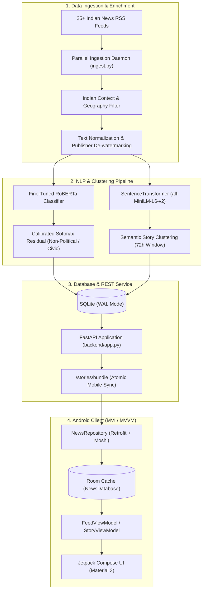

# NewsBias India 🇮🇳
### AI-Powered Multi-Source Political Bias Detection & News Aggregation Platform

[](android/)
[](android/)
[](android/)
[](backend/)
[](ml/)
[](docker-compose.yml)

**NewsBias India** is a Ground-News-style news aggregation and bias analysis platform built for the Indian media ecosystem. It ingests real-time reporting from over 25 major Indian news outlets across the political spectrum, uses fine-tuned transformer models to estimate political framing (`Left`, `Center`, `Right`, and `Non-Political`), clusters parallel reporting into unified multi-source stories, and presents balanced coverage through a native Android application.

---

## 📸 Key Features

* **Multi-Perspective Bias Estimation**:
  * Evaluates political framing across **Left**, **Center**, and **Right** leanings.
  * Employs calibrated residual classification to accurately isolate **Non-Political / Civic** events (ISRO launches, weather phenomena, civic infrastructure, and disaster reporting) with zero false political bias.
* **Context-Aware Speaker Attribution**:
  * Grammatical actor-target parsing handles colon attribution (`"Leader: Statement"`) and direct quotes so that opposition critique or ruling party statements are attributed to the speaker rather than misclassified as editorial bias.
* **Semantic Cross-Source Story Clustering**:
  * Leverages `SentenceTransformer` (`all-MiniLM-L6-v2`) cosine embeddings and named-entity overlap within a 72-hour sliding window to group divergent publisher coverage into unified, multi-source stories.
* **Live Ingestion Daemon**:
  * Multi-threaded parallel crawler ingesting 25+ RSS feeds every 30 minutes from major national broadsheets, wire agencies, and digital publications (*The Hindu, Times of India, NDTV, Hindustan Times, Indian Express, ThePrint, OpIndia, Organiser, Deccan Herald, etc.*).
* **Native Android Client**:
  * Built with modern **Jetpack Compose** and **Material 3** in a dark obsidian design (`#0B0D13`).
  * **Offline-First Architecture**: Android **Room** SQLite database caches stories and clustered articles atomically, ensuring instant loading even in airplane mode.
  * **Dynamic Category Filtering**: Seamlessly filter stories by `Politics`, `Civic & Factual`, `Judiciary & Law`, or `Economy`.
  * **Floating Scroll-To-Top**: Contextual floating action button that animates into view when browsing deep feeds.
  * **Sourcing Transparency**: Factuality badges (*High / Very High*, *Standard*, *Mixed*), publisher editorial backgrounds, and direct outbound reader links via Chrome Custom Tabs.

---

## 🏛️ System Architecture



---

## 🛠️ Technology Stack

| Layer | Technologies |
| :--- | :--- |
| **Android Client** | Kotlin 2.0, Jetpack Compose, Material 3, Hilt, Room SQLite, Retrofit2, Moshi, Coil 3, Chrome Custom Tabs, Coroutines & Flow |
| **Backend API** | Python 3.11, FastAPI, Uvicorn, SQLite (WAL mode), Pydantic v2 |
| **Machine Learning** | PyTorch, Hugging Face Transformers, RoBERTa, Sentence-Transformers, Scikit-learn, Trafilatura |
| **Data Ingestion** | Feedparser, Concurrent Futures, Trafilatura, Certifi |
| **Deployment** | Docker, Docker Compose, Procfile (Railway / Render / Heroku) |

---

## 📂 Repository Layout

```
NewsBiasDetection/
├── android/                   # Native Android application
│   ├── app/src/main/java/     # Kotlin Compose UI, ViewModels, Room DB, Retrofit API
│   │   └── com/codingsoham/newsbias/
│   │       ├── data/          # Room entities, DAOs, Retrofit API, NewsRepository
│   │       ├── ui/            # Screens.kt (Feed, Detail, Category Chips, InfoSheet)
│   │       └── ui/theme/      # Theme.kt, Color.kt (Obsidian palette)
│   └── build.gradle.kts       # Android Gradle configuration
├── backend/                   # FastAPI backend service
│   ├── app.py                 # REST API endpoints & lifespan daemon lifecycle
│   ├── ingest.py              # Parallel RSS crawler, NLP inference & clustering
│   ├── explain.py             # Source factuality tiers & descriptions
│   ├── indian_filter.py       # Geographical/national context validator
│   ├── attribution_resolver.py# Speaker & quote syntax parsing
│   ├── text_cleaner.py        # Publisher watermarking removal
│   └── run_daemon.py          # Standalone background worker runner
├── ml/                        # Machine learning training & evaluation
│   ├── train_transformer.py   # Transformer training scripts
│   ├── evaluate_model.py      # Benchmark evaluation
│   ├── collect_indian.py      # Dataset collector
│   └── calibrate.py           # Temperature scaling & probability calibration
├── docs/                      # Research documentation & data cards
├── Dockerfile                 # Production multi-stage Docker container
├── docker-compose.yml         # Container orchestration with volume persistence
├── Procfile                   # PaaS deployment manifest (Railway, Render)
├── requirements.txt           # Python backend dependencies
└── README.md
```

---

## 🚀 Quickstart Guide

### 1. Prerequisites
* **Python**: `3.11+`
* **Android Studio**: Ladybug / Hedgehog or newer with JDK 17
* **Docker** *(optional, for containerized execution)*

---

### 2. Backend & Ingestion Engine Setup

1. **Clone the repository**:
   ```bash
   git clone https://github.com/codingsoham/NewsBiasDetection.git
   cd NewsBiasDetection
   ```

2. **Create and activate a virtual environment**:
   ```bash
   python -m venv .venv
   # Windows:
   .\.venv\Scripts\activate
   # Linux/macOS:
   source .venv/bin/activate
   ```

3. **Install dependencies**:
   ```bash
   pip install --upgrade pip
   pip install -r requirements.txt
   ```

4. **Launch the FastAPI Server**:
   ```bash
   uvicorn backend.app:app --host 0.0.0.0 --port 8000 --reload
   ```
   *The server will automatically start the background ingestion daemon, fetching and clustering fresh news every 30 minutes.*

5. **(Optional) Run Standalone Ingestion Daemon**:
   To run the news scraper in a dedicated worker process:
   ```bash
   python backend/run_daemon.py
   # Or for an immediate single-pass update:
   python -m backend.ingest --run-once
   ```

---

### 3. Docker Deployment

Deploy with a single command:
```bash
docker compose up -d --build
```
* Mounts `./data` to persist news articles and predictions across restarts.
* Exposes the API on `http://localhost:8000`.
* Runs continuous background ingestion on a 30-minute schedule.

---

### 4. Android Client Setup

1. Open the `android/` directory in **Android Studio**.
2. Configure your backend URL:
   * **For Android Emulator**: Default is `http://10.0.2.2:8000/` (maps to host localhost).
   * **For Physical Device**: Set your machine's LAN IP (e.g., `http://192.168.1.X:8000/`) in `android/app/build.gradle.kts`.
   * **For Production**: Set your cloud domain (e.g., `https://api.yourdomain.com/`).
3. Sync Gradle and build:
   ```bash
   cd android
   ./gradlew assembleDebug
   ```
4. Run on your connected device or emulator:
   ```bash
   ./gradlew installDebug
   ```

---

## 🌐 API Reference

| Method | Endpoint | Description |
| :--- | :--- | :--- |
| `GET` | `/stories/bundle?limit=50` | Atomic bundle of recent stories + clustered articles for mobile Room sync |
| `GET` | `/stories?limit=100` | Aggregated story list with source counts and leaning percentages |
| `GET` | `/stories/{id}` | Detailed multi-source article breakdown for a specific story |
| `GET` | `/daemon/status` | Real-time health status, last sync timestamp, and run counts of the crawler |
| `POST`| `/refresh?force=true` | Triggers an immediate crawl across all 25 RSS feeds |
| `GET` | `/health/model` | Model status, F1 evaluation benchmarks, and metadata |

---

## ⚖️ Sourcing & Factuality Standards

NewsBias classifies outlet sourcing rigor into transparent tiers:

* **High / Very High**: Rigorous primary sourcing, established fact-checking protocols, verified independent reporting standards, and minimal retractions (*e.g., The Hindu, Live Law, NDTV, Reuters*).
* **Standard**: Established commercial news publishers and regional broadsheets providing mainstream coverage with standard wire and agency reporting (*e.g., Times of India, Hindustan Times, Times of Israel*).
* **Mixed**: Outlets with a pronounced ideological stance, commentary-heavy formats, or history of selective reporting where opinion-driven framing strongly influences coverage (*e.g., Organiser, The Wire, OpIndia*).

---

## 📜 Ethical Considerations & Disclaimer

> [!NOTE]
> Perspective ratings are estimated via natural language processing models and grammatical attribution heuristics. Language in political reporting is inherently nuanced; automated labels reflect linguistic framing patterns rather than absolute objective truth. NewsBias encourages readers to compare diverse sources, read full original reporting through the provided links, and form independent conclusions.

---

## 📄 License

This project is licensed under the [MIT License](LICENSE).

